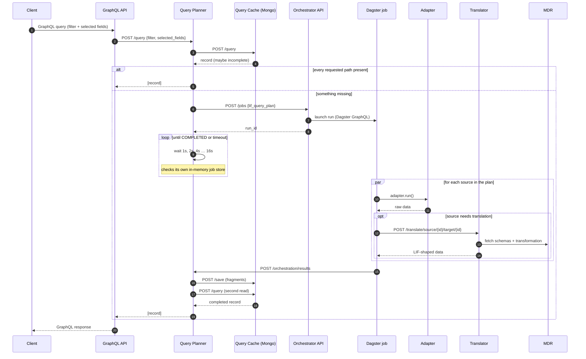

# 4. Follow the data: one query, end to end

What happens, service by service and file by file, when a client asks LIF for a learner's record.

*Checked against main `2967cb9`, November 2026.* Traced from the code, then watched on the local `advisor-demo-docker` stack:
every step below, the mutation path and a planner restart were observed. File paths are relative to
the repo root. Orchestrated queries need the Dagster images and the Orchestrator API built after #1504 and #1515 (11-12 and 11-13; see [chapter 1](01-dev-environment.md)).

---

## The short version

A client sends a GraphQL query for one person. The **GraphQL API** turns it into a plain JSON query and
hands it to the **Query Planner**. The planner asks the **Query Cache** (MongoDB) whether it already has
every piece of data the client asked for.

- **Everything is in the cache** → the planner returns it. Done. This is the common case.
- **Something is missing** → the planner works out which configured **information sources** can supply
  the missing pieces, and asks the **Orchestrator** to fetch them. The orchestrator starts a **Dagster**
  job. For each source, the job runs an **adapter** (to pull the raw data) and, if needed, the
  **Translator** (to convert it to LIF). The job posts the results back to the planner, which writes them
  into the cache. The planner then reads the cache again and answers the client.

The client never knows which case happened, except for timing and, when some data couldn't be fetched,
an `X-LIF-Partial` response header.



---

## Before you start: the shape of a deployment

LIF runs **one stack per organization**. In the local demo
(`deployments/advisor-demo-docker/docker-compose.yml`) there are three orgs, and each has its own:

| Service | org1 | org2 | org3 | Code |
|---|---|---|---|---|
| GraphQL API | :8010 | :8110 | :8210 | `bases/lif/api_graphql/` |
| Query Planner | :8002 | :8102 | :8202 | `bases/lif/query_planner_restapi/`, `components/lif/query_planner_service/` |
| Query Cache | :8001 | :8101 | :8201 | `bases/lif/query_cache_restapi/`, `components/lif/query_cache_service/` |
| MongoDB | :27017 | :27018 | :27019 | seeded from `projects/mongodb/sample_data/advisor-demo-orgN/` |

Wired for org1 only, locally: the **Orchestrator API** (:8005), **Dagster** (webserver, daemon, code
location, Postgres), the **Translator**, and the **example data source**. The **MDR** is shared by all
three orgs: it's on every org network, and each `lif-graphql-api-orgN` depends on it.

> **Port note.** Host ports for the per-org services come from the compose file; the GraphQL API listens on
> 8000 *inside* its container and is published as 8010/8110/8210.

The important consequence: **org1's own learner data is never "fetched".** It is seeded straight into
org1's MongoDB when the container starts. Orchestration only happens for data that lives somewhere
*else*: org2, org3, or a non-LIF source system.

---

## Step 1: the GraphQL API builds its schema from the MDR

**Where:** `bases/lif/api_graphql/core.py`, `components/lif/openapi_to_graphql/`

There is no hand-written GraphQL schema. At startup (`lifespan`), the service:

1. loads the LIF OpenAPI schema from the MDR (`lif.mdr_client.load_openapi_schema`; see
   [`docs/design/cross-cutting/schema-loading.md`](../../design/cross-cutting/schema-loading.md) for the fail-loudly rule),
2. generates Strawberry types from it (`openapi_to_graphql/type_factory.py`): output types, `filter`
   input types from fields marked `x-queryable`, and mutation input types from fields marked `x-mutable`,
3. mounts the result at `/graphql`.

That is the service's only API route (FastAPI's default `/docs`, `/redoc` and `/openapi.json` are served too). If `GRAPHQL_AUTH__API_KEYS` is set, `lif.auth` middleware
requires an `X-API-Key` header (see [`docs/operations/guides/graphql-api-keys.md`](../../operations/guides/graphql-api-keys.md)); locally it is usually
unset, so there is no auth.

**What this means for you:** a change to the data model in the MDR changes the GraphQL API the next time
it starts. You don't edit GraphQL types; you edit the model.

## Step 2: the resolver turns GraphQL into a planner query

**Where:** `build_root_query_type` in `components/lif/openapi_to_graphql/type_factory.py`

The root query field is `person(filter: …)`. Its resolver:

- flattens the `filter` argument into a dict (`input_asdict`),
- walks the GraphQL selection set to list every field the client asked for (`get_selected_field_paths`),
  in PascalCase, because that's what the stored documents use,
- POSTs `{"filter": {"Person": {...}}, "selected_fields": [...]}` to the planner's `/query`, with an
  `X-LIF-Client` header that names the caller for the query statistics.

On a 200 it converts the JSON back into the generated dataclasses. On anything else it **raises**, so the
client gets a GraphQL `errors` entry rather than an empty list that looks like "no such learner" (#1264).
The request timeout is `LIF_GRAPHQL_CLIENT_TIMEOUT_SECONDS`, falling back to `LIF_QUERY_TIMEOUT_SECONDS`,
then 20 s; the reason the two timeouts must be ordered is in [`docs/design/cross-cutting/timeouts.md`](../../design/cross-cutting/timeouts.md).

## Step 3: the planner asks the cache first

**Where:** `run_query` in `components/lif/query_planner_service/core.py`; endpoint `do_run_query_sync` in
`bases/lif/query_planner_restapi/core.py`

The planner forwards the query to the cache's `/query`. Then:

- **more than one record** comes back → error. A query must identify exactly one person.
- **every requested fragment path is in the record** → return it. Outcome `served_from_cache`.
- **some paths are missing** (or there is no record at all) → go to step 4.

"Fragment path" is the planner's unit of data: two levels deep, like `Person.Contact` or
`Person.CourseLearningExperience`. The selected fields are reduced to these paths by
`util.get_lif_fragment_paths_from_query`.

**The check is per path, not per field.** If the cached record has *any* `Person.Name`, then
`Person.Name` counts as present, even when the sub-field you asked for isn't in it. Measured: asking
org1 for `Name { informationSourceSystem }`, which org1's record lacks, returned `null` with outcome
`served_from_cache`, and nothing was fetched, though org2 is configured as a source for `Person.Name`.

## Step 4: the planner builds a query plan from its sources config

**Where:** `util.create_lif_query_plan_from_information_sources_config`; config file
`deployments/advisor-demo-docker/volumes/lif_query_planner/org1/information_sources_config_org1.yml`
(path set by `LIF_QUERY_PLANNER_INFORMATION_SOURCES_CONFIG_PATH`)

Each planner has a YAML list of **information sources**. org1's says:

| `information_source_id` | `adapter_id` | Fragment paths it can supply | Translation |
|---|---|---|---|
| `org2` | `lif-to-lif` | Name, Contact, Identifier, EmploymentLearningExperience, PositionPreferences | none (already LIF) |
| `org3` | `lif-to-lif` | Name, Contact, Identifier, CredentialAward, CourseLearningExperience, Proficiency | none |
| `org1-example-data-source` | `example-data-source-rest-api-to-lif` | EmploymentPreferences | MDR model 26 → 17 |

The plan has one **part** per source whose paths overlap the *requested* paths, not just the missing
ones. (The code comment explains: asking only for the missing paths stopped org3 from contributing when
org1 already had a path with the same name.) You can see this in the logs: a query for `Name` plus
`PositionPreferences`, where only `PositionPreferences` was missing, produced
`Created LIF Query Plan: 2 part(s): org2/lif-to-lif (2 path(s)); org3/lif-to-lif (1 path(s))`, because
org3 can also supply `Person.Name`.

If no source matches, the planner returns what the cache had with outcome `no_sources_available`.

Note that org1 does not list *itself*: its own data was seeded into its cache (see the deployment note
above).

## Step 5: the orchestrator starts a Dagster run

**Where:** planner `post_orchestrator_job` → `bases/lif/orchestrator_restapi/core.py` (`POST /jobs`) →
`components/lif/orchestrator_service/service.py` → `components/lif/orchestrator_clients/dagster.py`

The orchestrator API is a thin pass-through. `POST /jobs` wraps the plan in a job definition and the
`DagsterClient` submits a run of `lif_dynamic_pipeline_job` through Dagster's GraphQL API
(`ORCHESTRATOR__DAGSTER__GRAPHQL_API_URL`). It returns Dagster's `run_id`. The API also has
`GET /jobs/{id}` and `/health`; the result and cancel endpoints are commented out.

If the submission fails, the planner returns what the cache had, with outcome
`orchestrator_submission_failed` (a 503 if that was nothing).

On success, the planner stores a `PENDING` job under the `run_id` in **`JOB_STORE`, an in-memory dict**.
Restarting the planner loses every in-flight job.

## Step 6: the planner waits

**Where:** the polling loop in `do_run_query_sync`

The `/query` endpoint is synchronous from the caller's point of view. It polls **its own job store**
(not Dagster) with exponential backoff, 1 s doubling to 16 s, until the job is `COMPLETED` or
`LIF_QUERY_TIMEOUT_SECONDS` (default 300) runs out, which returns a **408**.

(There is also `/query_async` plus `/query/{id}/status` for callers that want to poll themselves. The
code comments say the sync endpoint is temporary; it is what the GraphQL API uses today.)

The backoff is visible in the timing. In one observed run the Dagster results arrived 8 s into the
wait, but the planner was mid-sleep and answered 8 s later: about half of the 15.8 s total was idle
polling. Locally, compose sets `LIF_QUERY_TIMEOUT_SECONDS` to 120, not the code default of 300.

## Step 7: the Dagster job fans out over the sources

**Where:** `orchestrators/dagster/lif-orchestrator/src/lif_orchestrator/defs/lif_job.py`

> The job's source lives under `orchestrators/`, and the Docker projects in `projects/dagster_*/` copy it
> into their images (`Dockerfile.code_location`). Both places matter.

The graph is `create_dynamic_pipelines` → (for each plan part, in parallel) `run_lif_adapter` →
`run_translation` → `send_results_to_query_planner` (after all parts finish).

**`run_lif_adapter`** looks the adapter up by `adapter_id` in `ADAPTER_REGISTRY`
(`components/lif/data_source_adapters/__init__.py`):

- `lif-to-lif` is built in (`components/lif/data_source_adapters/lif_to_lif_adapter/`). It POSTs a stored
  all-fields GraphQL query (`graphql_query_all_fields_org2.graphql`, `…org3.graphql`) to **the other
  org's GraphQL API**. That other org then runs this same flow from step 1 against *its own* cache, where
  the data was seeded. It doesn't go any further: org2's and org3's planners have empty sources configs,
  so if their cache lacks the learner they log `Information sources config is empty` and return nothing.
- `example-data-source-rest-api-to-lif` is a demo adapter in `components/lif/demo_data_source_adapters/`,
  added to the registry at import time by `register_demo_adapters`. It calls the example source system
  (`bases/lif/example_data_source_rest_api/`).

Credentials come from environment variables on the Dagster container (`get_credentials_for_adapter`).
If an adapter keeps failing after its retries, the op returns no data rather than failing the run; the
source is then reported as failed in step 8.

**`run_translation`** does nothing for parts with no `translation` block. For the others it POSTs the
raw data to the Translator at `/translate/source/{source_schema_id}/target/{target_schema_id}`
(step 7a).

**`send_results_to_query_planner`** POSTs every part's fragments (or error) to the planner's
`/orchestration/results` (`LIF_QUERY_PLANNER_RESULTS_BASE_URL`).

### Step 7a: the Translator

**Where:** `bases/lif/translator_restapi/core.py`, `components/lif/translator/core.py`

For every request the Translator fetches the **transformation** (the JSONata mappings) from the MDR, and
the source and target schemas when they're not in its 5-minute schema cache. The transformation is the pair's **active transformation group**:
since #1350, a group only counts when it has an `ActivationDate` in the past and no past
`DeprecationDate` (`get_active_transformations_for_data_models` in
`components/lif/mdr_services/transformation_service.py`). If there is none, the Translator returns 404
and the source fails. Then it then validates the input against the source schema, evaluates each
JSONata expression, merges the results, and validates against the target schema. Schemas are cached in
process; transformations are deliberately **not** cached, so an edit in the MDR takes effect on the very
next translation. There is no `/initialize` step in the service (that exists only in a test harness,
`base_test.py`).

## Step 8: the planner saves the results into the cache

**Where:** `run_post_orchestration_results` in the planner service → cache `POST /save` →
`save` in `components/lif/query_cache_service/core.py`

The planner looks the job up by `run_id`, collects the fragments, and records any source that returned
an error in `job.failed_source_ids`. It POSTs the fragments to the cache's `/save`, then marks the job
`COMPLETED`.

The cache finds the person's document (or starts a new one), merges the fragments in with the
**Composer** (`components/lif/composer/core.py`, `compose_with_fragment_list(..., replace_existing=True)`:
new data for a path *replaces* the old, #1165), and upserts it into MongoDB.

Two consequences you will meet (#1492). First, the planner re-fetches **every** requested path, not only
the missing ones (comment at `components/lif/query_planner_service/core.py:157`), so one missing field
replaces the org's own lists for all the other requested paths with the partners' data. Second, the org2
lif-to-lif query leaves out `identifierType`, so the replaced `Identifier` list no longer matches the
next query's filter. The cache then misses and `save` starts a new document: a duplicate learner.

## Step 9: the planner answers

Back in the polling loop, the job is now `COMPLETED`, so the planner calls `run_query` a second time.
This reads the cache again, which now holds the fetched paths, and returns the record.

- If a source failed during the job, the planner's response carries `X-LIF-Partial: source_failed` (or
  a 503 if there were no records at all). **A GraphQL client doesn't see that header**: the GraphQL API
  doesn't pass it on (open issue #1308), so the missing field just comes back `null`.
- If the planner gives up waiting, it returns a 408, and the GraphQL client gets an `errors` entry,
  `"Query failed: 408"`.
- If every source succeeded but a path is still missing, that most likely means the learner just has no
  such data, and the record is returned normally.

The GraphQL API turns the record back into GraphQL types (step 2) and the client gets its answer.

---

## Mutations take a much shorter path

A GraphQL mutation (`updatePerson`) goes: GraphQL API → planner `POST /update` → cache
`POST /update` → MongoDB. No orchestration, no sources: an update only changes the local cache.
Checked 11-07: the orchestrator logged nothing, and the cache log shows `UPDATE DOC fields: {'$push': ['Person.0.Interactions']}`.

Two things to know:

- **Only `x-mutable` fields can be changed.** In model 17 today that is just `Interactions`
  (`PersonMutableInput` has no other field: check with introspection, as in "Try it yourself").
- **A mutation appends lists.** The cache `$push`es list fields' new items and `$set`s scalar fields. In
  model 17 today the only mutable field, `Interactions`, is a list, so a mutation appends.

```bash
curl -s localhost:8010/graphql -H 'content-type: application/json' -d '{"query":"mutation { updatePerson(filter:{Identifier:[{identifier:\"100005\", identifierType:\"SCHOOL_ASSIGNED_NUMBER\"}]}, input:{Interactions:[{interactionId:\"my-test-1\", summary:\"test\"}]}) { Interactions { interactionId summary } } }"}'
```

This writes to org1's cache, which `docker compose up` won't undo: reset it afterwards ([chapter 1](01-dev-environment.md)).

---

## Things that surprise people

- **The Identity Mapper is not on this path.** `bases/lif/identity_mapper_restapi/` is deployed, and the
  older design docs draw the planner calling it, but nothing in the repo calls it today.
- **Cached data never expires.** Every source has a `ttl_hours` in the YAML, and the planner loads it, but
  no code reads it. Once a path is in the cache, it is served from the cache until the document changes.
  Locally, that survives container restarts too (see "Try it yourself" for how to reset).
- **The job store is in memory.** Restarting a planner mid-query loses the job. Checked 11-07: the
  client's connection drops; when Dagster posts the results, the planner answers 500
  (`Job with ID … not found in JOB_STORE`), Dagster marks the run `FAILURE`, and nothing reaches the
  cache.
- **A new sub-field never triggers a fetch on its own.** Because the cache check is per two-level path
  (step 3), adding a field under `Name` won't make org1 ask org2 for it while org1 has any `Name` cached.
- **A stopped hop looks the same as a failed source.** If the Translator (or a source system) is down,
  the Dagster step fails with a `ConnectionError`, the planner logs
  `Pipeline did not run or failed` and `Sources failed during orchestration`, and GraphQL returns `null`.
  The stopped service's own log just goes quiet. Check `docker ps -a` first ([chapter 8](08-debugging-and-traps.md)).
- **A failed source is quiet from GraphQL.** The field is `null`, exactly as if the learner had no data.
  The reason is in the org's planner log (`Sources failed during orchestration`) and in Dagster's run log.
- **The orchestrator is not the scheduler.** Dagster does the work; the orchestrator API only submits runs.
- **PascalCase matters.** Fragment paths, selected fields and stored documents are PascalCase
  (`Person.Contact`). A lower-case path silently matches nothing. See [`docs/specs/data-model-rules.md`](../../specs/data-model-rules.md).

---

## Try it yourself

With the stack running ([chapter 1](01-dev-environment.md)), use learner `100006`. org1's seed has their `Name` but not
`PositionPreferences` (org2 has that) or `EmploymentPreferences` (only the example source system has
that). A helper that posts a query to org1's GraphQL API:

```bash
q() {  # usage: q '<selection set>'
  curl -s -w '\n%{http_code} in %{time_total}s\n' -H 'Content-Type: application/json' http://localhost:8010/graphql \
    --data "$(printf '{"query":"query($f: PersonInput){ person(filter:$f){ %s } }","variables":{"f":{"Identifier":[{"identifier":"100006","identifierType":"SCHOOL_ASSIGNED_NUMBER"}]}}}' "$1")"
}
docker logs -f lif-query-planner-org1   # in a second terminal, to watch the planner
```

| # | Run | You should see (observed 2026-11-07) |
|---|---|---|
| 1 | `q 'Name { firstName lastName }'` | ~0.5 s. Planner: `LIF Record contains all requested fields, returning directly.` and `"outcome": "served_from_cache"`. |
| 2 | `q 'Name { firstName } PositionPreferences { Travel { percentage } }'` | ~16 s. Planner: `missing: ['Person.PositionPreferences']`, `Created LIF Query Plan: 2 part(s): org2/lif-to-lif …; org3/lif-to-lif …`, the polling lines, `Received orchestration results`, then the second cache read. A run of `lif_dynamic_pipeline_job` appears in Dagster's UI at http://localhost:3000. org2's planner logs a cache hit. |
| 3 | Repeat query 2 | ~0.1 s, `served_from_cache`. The fetched data is now in org1's cache. |
| 4 | `q 'EmploymentPreferences { organizationTypes }'` | ~16 s. One plan part, `org1-example-data-source`. The Translator (`docker logs advisor-demo-docker-lif-translator-org1-1`) fetches MDR schemas 26 and 17 and the active 26 → 17 group, then logs `Translation complete … applied=1`. Result: `["Non-Profit", "Public Sector"]`. |

**Exploring further.**

- *Which learners exist?* Each org's seed is in `projects/mongodb/sample_data/advisor-demo-orgN/`, or ask
  the database:
  `docker exec mongodb-org1 mongosh LIF --quiet --eval 'db.person.find().forEach(p=>print(JSON.stringify(p.Person[0].Identifier)))'`.
  Change `100006` in the helper to try another.
- *Which fields can I ask for?* The GraphQL types are generated, and their names aren't the entity names:
  `CredentialAward` under `Person` is the type `PersonItemCredentialawardItem`. Ask GraphQL itself:

  ```bash
  curl -s -H 'Content-Type: application/json' http://localhost:8010/graphql \
    --data '{"query":"{ __type(name:\"PersonItemCredentialawardItem\"){ fields { name } } }"}'
  ```

  (List every type name with `{ __schema { types { name } } }`.) Field names inside a selection are the
  model's names: `CredentialAward { identifier awardIssueDate }`.
- *Which services did a query touch?* Note the time, run the query, then
  `docker logs --since <time> <container>` for each service. A cache hit only reaches the GraphQL API, the
  planner and the cache.
- *Log lines that look alarming but aren't:* the GraphQL API logs
  `WARNING … Result objects is list nested in list. Will return inner list.` on every successful query,
  and its `N selected field(s)` count includes the parent paths, not just the fields you typed.

To start again from the seed data, **recreate** the org's MongoDB container and its volume.
`docker restart` is not enough: the mongo image keeps `/data/db` on an anonymous volume, so the data
survives a restart.

```bash
cd deployments/advisor-demo-docker
docker compose rm -sfv mongodb-org1 && docker compose up -d mongodb-org1   # -v drops the anonymous volume
```

---

## Where to go next

- Each service's own README (`bases/lif/<service>/README.md`) for its endpoints and configuration.
- [`docs/design/cross-cutting/timeouts.md`](../../design/cross-cutting/timeouts.md) for how the timeouts fit together.
- [`docs/operations/guides/creating-a-data-source-adapter.md`](../../operations/guides/creating-a-data-source-adapter.md) to write a new adapter.
- [`docs/operations/guides/jsonata-quick-start-guide.md`](../../operations/guides/jsonata-quick-start-guide.md) for transformations.
- The service design docs in `docs/design/components/` give background, but several describe an older
  design (for example, the planner calling the Identity Mapper). Trust the code and the READMEs where they disagree.
