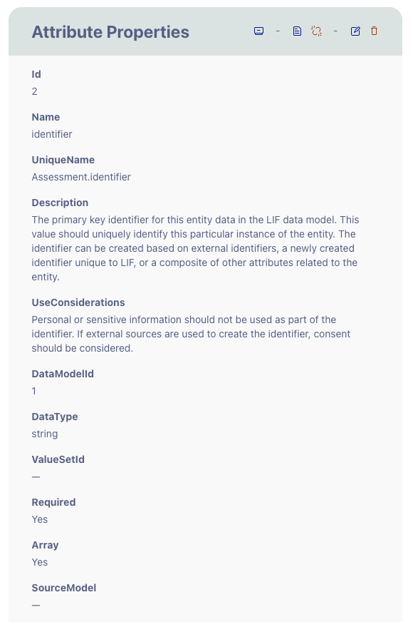
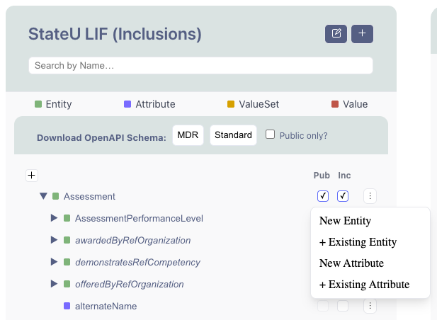
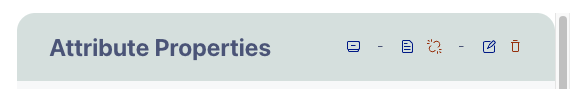
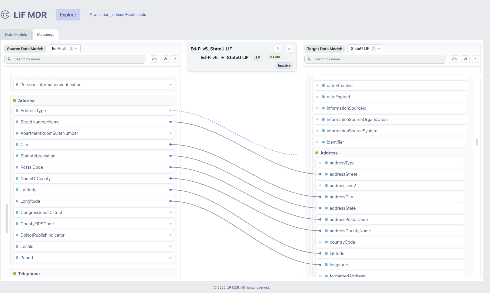

# LIF MDR Getting Started (Non-Technical)

Non-technical walkthrough of the LIF MDR demo: creating an account, building an organizational data model, and mapping Ed-Fi to it.

## Getting Started with the LIF MDR

The LIF MetaData Repository (MDR) allows you to define your organization's data model and map it to other data models.

This guide walks you through three key steps:

1. Creating your LIF MDR account
2. Creating your organizational data model in the LIF MDR
3. Mapping a source data model to a target data model (Ed-Fi example)

This guide is designed for non-technical users and focuses on the core workflow.

## Creating an Account for LIF MDR

This process explains how to register for the LIF MDR demo provided by the LIF team. This does not cover how to set up the LIF MDR locally. For more on that process, please refer to the LIF technical documentation.

There are two ways to use the LIF MDR. One way is to use it alone without any other contributors. This method allows you to use the LIF MDR without anyone else changing your Org Data Model. The other way is to share a workspace so you can collaborate on changes to a single Org Data Model. To use the collaboration method, one team member should register as a new user, then use the invite link to add additional collaborators.

### Step 1: Open the Registration Page

1. Navigate to the LIF MDR demo: <https://mdr.demo.lif.unicon.net>
2. Click 'Sign In / Register' on the landing page.
3. When the sign-in page loads, click 'Sign up'.

### Step 2: Enter Required Information

Complete the registration form with the following:

- Email Address (used for login username)
- Password
    - Password must contain a lower case letter
    - Password must contain an upper case letter
    - Password must contain a number
    - Password must contain at least 8 characters
    - Password must not contain a leading or trailing space

### Step 3: Submit the Form

Click 'Sign up' once the required fields are complete.

### Step 4: Verify Your Email

After registering, check your email inbox for a verification code. Enter the verification code, and click 'confirm account.' If you don't receive a code, check your spam folder or click the link to 'Send a new code.'

### Step 5: Log In to the MDR

Once verified, you will be logged into the MDR. Your workspace and Org Data Model will be ready for use.

### What to Expect After Login

- A private workspace is created for you. Every new account gets its own workspace, including accounts created from an invite link.
- The base LIF data model and Source data models are preloaded.

### Sharing a Workspace

If you have others on your team that you would like to invite to share your workspace follow these steps:

1. Log in to the MDR.
2. Click your email address in the navigation bar
3. Click switch workspace
4. You will see a list of workspaces, you may only have one workspace
5. Click the Invite button.
6. Click the Generate invite link. This will generate a URL that you can share with someone. When they open the link, they'll be asked to sign in or register, then accept the invite. Your workspace then appears alongside their own, and they can open it from the workspace list.
7. To return to your workspace after sending the invite link, click Open next to the workspace you want to return to

### Joining a Shared Workspace (Optional)

If you received an invite link, you still need your own LIF MDR account. Follow these steps:

1. Open the invite link. If you are not signed in, you will be sent to the sign-in page. Sign in, or click 'Sign up' and register using the steps above.
2. After signing in, you will return to the invite page. Click 'Accept invite'.
3. Click 'Sign in again to refresh' and sign in once more. This updates your account with the new workspace.
4. You will now see both your own workspace and the shared workspace. Click Open next to the shared workspace to start working in it.

Invite links expire after 7 days. If yours has expired, ask the workspace owner to generate a new one.

### Joining a Shared Workspace if you have already registered as a new user

If you already have an account and want to join a shared workspace, ask the workspace owner for an invite link and follow the steps above. Your own workspace stays as it is, and any changes you've made in it are not copied to the shared workspace. For a detailed walkthrough of the registration and invite flow, see the [Self-Serve Registration Walkthrough](../operations/guides/self-serve-registration-walkthrough.md).

## Creating an Organizational Data Model

Your Organizational Data Model is your customized version of the LIF data model. It allows you to define exactly what data your organization uses. To learn more about Data Models, please view the [LIF Data Model Guide](../overview/data-model-guide.md).

### Overview of the Data Models Tab

#### Left Panel – Data Model Selector

- Displays all available models (LIF, Org LIF Model (name will vary by organization), Source Models, Partner Models)
- Used to select a model

#### Middle Panel – Data Model Hierarchy Viewer

- Displays data model in a hierarchy view
    - Entities are green
    - Attributes are purple
    - ValueSets are orange
    - Values are red
- Clicking on any of the entities, attributes, valuesets, or values will display all of that item's properties in the right panel

#### Right Panel – Item Properties

- Displays details such as:
    - Name
    - Description
    - Data type
    - Required status

This is the primary way to navigate and manage models.

### Step 1: Using the Data Model

In the Data Model Selector (left panel), the StateU LIF data model is already added to your MDR. You can edit the name of this data model to match your organization.

1. Click StateU LIF in the left panel
2. Click the edit button (paper and pencil) in the middle panel
3. Edit the Name of the data model
4. Click Save and now the data model is renamed to the name you selected

You can edit this data model by adding, removing, including, or excluding data elements.

### Step 2: Include or Exclude Data Elements

1. Select your data model
2. Open Base LIF Inclusions
3. Use the Inc checkboxes in the middle panel to:
    - Include elements you need (checked)
    - Exclude elements you don't (unchecked)

This allows you to simplify your model to match your organization's needs.

### Step 3: Explore Entities and Attributes

In the middle panel:

- Expand entities like Assessment or Person
- Click an attribute (e.g., "identifier")

In the right panel:

- You will see details such as:
    - Unique name (e.g., Assessment.identifier)
    - Description
    - Data type
    - Whether it is required

This helps you understand how each data element is defined.

### Step 4: Add New Elements (Optional)

You can extend your model by adding:

- New entities
- New attributes
- New Value sets
- New Values

To add a new Entity at the root, click the plus button at the top of the middle panel.

To add a new element to an existing element:

- Click the three-dot menu next to an item where you want to add a child
- Choose what you want to add

Entities can have entities and attributes as children. Attributes can have ValueSets as children. ValueSets can have Values as children.

Existing elements can also be added in the same way as adding a new item element.

Any additions apply only to your organization's data model.

### Attribute Property Icons

At the top of the third panel, in the attributes properties panel, there are several icons. Below is a list of those icons and their purpose. Note that not all icons will show for all items.

1. The first icon, edit inclusion () allows you to edit how the item is included in the data model. This is where you set the level of access, if the item is queryable, and if the item is modifiable.
2. The second icon, edit association () allows you to edit some of the details of the item, such as the contributor and contributor organization.
3. The third icon, delete association () allows you to remove the current association between the item and its parent.
4. The fourth icon, edit item () allows you to edit the details of the item.
5. The fifth icon, delete item () allows you to remove the item from the data model.

## Mapping a Source Data Model to a Target Data Model

The Mappings tab allows you to connect fields from a source data model to a target data model. In this example, we'll be mapping Ed-Fi (source data model) to State U (target org data model)

### Overview of the Mappings Tab

#### Left Panel – Source Data Model

- Contains source data model fields in a hierarchical view
- Elements are nested inside their parent element's box
- Dots on the right side of the left panel are for drag-and-drop mapping

#### Right Panel – Target Data Model

- Contains target data model fields in a hierarchical view
- Elements are nested inside their parent element's box
- Dots on the left side of the right panel are for drag-and-drop mapping

#### Center Area

- Mapping version listed at the top
- Displays mappings between fields
- Lines represent connections

### Step 1: Select Models

At the top of the mapping screen:

- Source Data Model (left): Select Ed-Fi v5
- Target Data Model (right): Select your model

### Step 2: Locate Fields to Map

Source (Ed-Fi):

- AssessmentIdentifier
- AssessmentTitle
- AssessmentScore

Target (Your Model):

- identifier
- name
- AssessmentPerformanceLevel

### Step 3: Create a Mapping

To connect fields:

1. Click the dot next to a source field
2. Drag to a corresponding target field, a dotted line represents the line being drawn
3. Release to create the connection, a solid line represents that the two items are connected

### Step 4: Example Mapping (Ed-Fi → LIF)

| Ed-Fi Field (Source) | Org LIF Field (Target) | Example Description |
|---|---|---|
| AssessmentIdentifier | identifier | Unique ID of the assessment |
| AssessmentTitle | name | Human-readable name |
| AssessmentScore | AssessmentPerformanceLevel | Represents performance result |
| AcademicSubject | (mapped to relevant subject field) | Subject area |
| AssessedGradeLevel | (mapped to grade level field) | Grade level |

What this means:

- Data coming from Ed-Fi will be translated into your Org LIF structure
- Each connection defines how one field becomes another using a JSONata expression.

### Step 5: Understanding Transformations

When you create a mapping:

- A default JSONata transformation is automatically applied
- This controls how the data is converted
- Double-clicking a connection line allows you to view or edit the JSONata

Most users can rely on the default transformation.

### Step 6: Continue Mapping

Repeat the process for all fields you need. You do not need to map everything. Focus on the data that matters to your organization.
