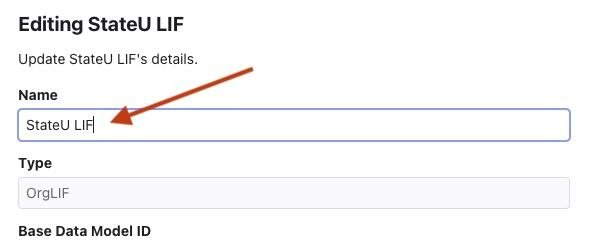

# LIF MetaData Repository (MDR) Guide (Draft)

User guide to the MDR: its concepts, local setup, interface, and how to manage data models, mappings, and JSONata transformations.

## Purpose of this document

The purpose of this document is to provide an understanding of what the MDR is, how to set it up locally, and how to use it.

## Audience and Assumptions

### Intended audience

This guide is intended for users who are responsible for implementing, configuring, or maintaining LIF using the MetaData Repository. This includes, but is not limited to:

- LIF stewards or administrators responsible for maintaining metadata and governing data model changes
- Technical implementors configuring LIF for an organization
- Data architects and data modelers are responsible for defining an organization's data model
- Integration engineers are responsible for mapping source system data to an organization's data model

### Assumed knowledge

The information in this guide assumes that the reader has:

- A general understanding of LIF
- Familiarity with data modeling concepts such as entities, attributes, relationships, and value sets.
- Experience working on structured data formats, such as JSON
- An understanding of how data flows from source systems to consumers

### What this guide does not cover

This guide focuses on how to use the MDR for managing data models, mapping, and transformations. It does not cover:

- A full conceptual overview of the LIF Data Model. [The LIF Data Model Guide can be found here](https://docs.google.com/document/d/1MaCo8gGHTW00Ax9ARphus55SJGgUNjoz7QmbMX_B8iU/edit?usp=sharing).
- Detailed justification for the data model design decisions. [The LIF Data Model Rules can be found here](../../specs/data-model-rules.md).
- Instruction on JSONata beyond what is required to edit transformations. [More on JSONata can be found here](https://jsonata.org/).
- Guidance on building downstream LIF services or applications

## MDR Concepts and Terminology

This section defines key concepts and terminology as they relate to the MDR. These terms are referenced throughout this guide and are specific to how data models, mappings, and relationships are managed in the MDR.

### Entity vs attribute vs value set vs values

An Entity is a group of related data elements. In the data model schema, an entity is a JSON object that may contain attributes, sub-entities, and associations to other entities.

An Attribute is a unit of data within an entity. Attributes make up individual fields in the JSON schema, such as identifiers, dates, and descriptive values.

A Value Set is a controlled list of allowed values for an attribute, also known as an enumeration or enum. Value sets are used to increase consistency and interoperability by constraining how certain data values are represented.

Values are the list of values within a Value Set.

### Data model types (Base, Org, Source, Partner)

The MDR includes several types of data models, each with its own purpose.

The Base LIF Data Model, or Base LIF, is the foundational data model maintained by the LIF steward. It defines the core structure and elements used across LIF implementations.

An Organizational Data Model, or Org LIF, is an organization-specific implementation of the LIF data model. It is derived from the Base LIF Data model and can include or exclude elements, add new entities, and add new attributes.

Source Data Models represent existing, standards-based data models from which learner data may originate. These models correspond to commonly used education, credentialing, and workforce data standards, such as Open Badges, CEDS, Ed-Fi, and others. In the MDR, Source Data Models are included in their original or canonical form and are used as the source side of mappings. They allow organizations to translate data from established standards into their own data model without modifying the standards themselves. Source Data Models are not organization-specific schemas. Instead, they provide a consistent starting point for mapping data from widely adopted standards and systems into LIF, supporting interoperability and reducing the need to recreate or reinterpret existing data models.

Partner Data Models represent external or partner-specific schemas that are not formal data standards, but are important for mapping.

### Additional Terminology

Mapping is when one attribute in a data model is connected to an attribute in another data model. This is done by dragging a connecting line between the two attributes.

Transformation is how the data is modified when two attributes are mapped. The transformations are handled by JSONata expressions and can be edited using the transformation editor.

Inclusion is when an object is included from one data model within the Org LIF data model to expand the data model. When an object is included, it is visible when exporting the schema from the MDR.

Exclusion is when an object is excluded from the base LIF data mode within an Org LIF data model. When an object is excluded from the Org LIF data model, it does not appear in the schema export from the MDR.

## What is the MDR

The MDR or MetaData Repository is a standalone component that serves as the LIF system of record. It is where individuals from implementing organizations maintain their organization-specific LIF data model and partner LIF data models through a graphical user interface. The MDR enables an organization to define which elements of its organization-specific LIF data model can be shared externally as its partner-accessible LIF data model. The MDR is also used to create mappings and translations between various data models and an organization's data model. The MDR and base LIF data model repository are maintained by the steward or organization governing LIF.

### MDR's Role in the LIF Architecture

The MDR serves as the authoritative source for all schema definitions and data mappings across the LIF ecosystem. When services like the LIF GraphQL API, Translator, or Semantic Search MCP Server start up, they fetch their schema information from the MDR. This ensures every service works with the same understanding of what learner data looks like and how it should be structured. The MDR defines three critical pieces of information:

1. schema definitions - the structure of Base LIF, Organization LIF, and source data models
2. data mappings - which fields in one data model correspond to fields in another
3. transformation logic - JSONata expressions that specify how data should be modified when moving between formats.

The MDR's authoritative role means that changes made in the MDR, such as excluding an attribute from the Organization data model or updating a transformation mapping, determine what becomes possible throughout the system. The GraphQL API cannot expose a field for querying unless it exists in the MDR schema. The Translator cannot transform source system data into LIF format without mappings defined in the MDR. The Semantic Search MCP Server cannot build search indexes without schema metadata from the MDR. This centralized approach provides a single point of control for data governance, enables non-technical users to manage data structure through a graphical interface, and ensures consistency across all LIF services. [Please see this document for more detailed information about MDR's relationships with specific services and why it is the authoritative source](https://docs.google.com/document/d/1PN4sDqIt1Cb-mgEijU84LPCSnzGwynZSP0TXLGhbOwc/edit?usp=sharing).

## MDR Setup

1. Download the [lif-core GitHub repository](https://github.com/LIF-Initiative/lif-core) locally.
2. Follow the Readme instructions found at [/frontends/mdr-frontend/](https://github.com/LIF-Initiative/lif-core/blob/main/frontends/mdr-frontend/README.md)

## Data Models in the MDR

The MDR includes several data models, including the base LIF data model, Source Data Models, Partner Models, and if created, an Organization's data model.

### Base LIF Data Model

The base LIF data model is the foundation of all LIF data models. It incorporates data points from multiple sources. More about the LIF data model can be found here: [LIF Data Model Manual (Draft)](https://docs.google.com/document/d/1MaCo8gGHTW00Ax9ARphus55SJGgUNjoz7QmbMX_B8iU/edit?tab=t.0#heading=h.dvmmzem12q7i)

### Organization's Data Model

When using LIF, an organization is required to create its own data model that will support its data needs. The initial organization data model is created from the base LIF data model and can be modified to include or exclude items.

### Source Data Models

Source data models are the data models that were used to create the base LIF data model. Those data models have been included in their original form and can be mapped to an Organization's data model. Note that the source data model versions are based on the version added to the MDR when the MDR was created. New versions can be added locally by individual users, by contributors via a PR to the GitHub repo, or by the steward if the community submits a request.

### Partner Models

Partner data models are supplementary data models that are not a data standard, but are important for organizations to map data from. An example of this would be a specific data model for a Student Information System (SIS) or Learning Management System (LMS).

## Interface Overview

### MDR Tabs

#### Data Model Tab

The Data Model tab is for viewing and editing data models. There are three panels that are part of the data model tab: Data Model Selector (left panel), Entity and attribute panel (middle panel), and Detail and Action panel (right panel). When first loaded, only the Data Model Selector panel is shown. In the Data Model Selector panel, you can select which data model you want to view or edit. After selecting a data model, the other two panels are displayed. The Entity and attribute panel (middle panel) shows the data model in a hierarchical view. Each object can be expanded to show the child objects. The Detail and Action panel (right panel) shows the properties of the selected object and allows for editing the details of the object.

More details on using the Data Model tab and its features can be found in the rest of this document.

#### Mapping Tab

The MDR features a mapping tab that allows for the mapping between data models. On this tab, the left side displays the source data model, while the right side shows the organization's data model, also known as the target data model. After selecting the source data model from the dropdown on the left, all elements for that model are shown. Using the dot next to each attribute, click and drag from one dot on the left to one dot on the right to create a mapping between the source and target data models. A source attribute can connect to one or more attributes in the target data model.

## Designing an Organization LIF Data Model

Each organization creates a LIF Data Model that can include or exclude existing elements from the Base LIF Data Model, create new entities and attributes to customize the data model for the organization's needs, create mapping between Source Data models and Partner Data models to the Organization data model, and perform transformations on the data.

### Creating an Organization Data Model

Using the MDR (MetaData Repository), an organization can create one data model tailored to its needs. (At this time, it is not possible to create a new organization data model or delete the StateU demo data. As a temporary solution, the StateU data model can be edited to create an Organization's own data model.)

1. To edit the StateU LIF data model, open the MDR
2. Select the StateU LIF data model from the data model selector
3. In the middle panel, select the edit icon

    

4. Replace the current name, StateU LIF, with an updated name and click save.

    

### Including or Excluding Entities and Attributes

Entities and attributes from the Base LIF data model can be included or excluded by selecting the associated checkbox next to each Entity or Attribute.

1. Open the MDR.
2. In the Data Model Selector, select the Organization Data model created.
    - Note: For this example, the data model is called StateU.
3. Expand the Organization Data model
4. Select Base LIF Inclusions
5. In the middle panel, find the attribute you want to include or exclude. Use the arrows to expand and collapse the schema to see all the Entities and Attributes.
6. Check the checkbox under the Inc column to include the Entity or Attribute, uncheck the checkbox to exclude the Entity or Attribute.

### Adding New Entities, Attributes, & Value Sets

Any additions made to an organization's data model are only available in that data model.

#### Adding New Root-Level Entities

New root-level Entities can be added to the organization's data model by selecting the data model that you want to add to from the Data Model Selector in the MDR and clicking the plus button in the middle panel.

#### Adding Sub-Entities and Attributes

Sub-entities and new Attributes can be added by clicking the 3 vertical dots button for an existing Entity and choosing either New Entity, + Existing Entity, New Attribute, or + Existing Attribute.

#### Adding Value Sets and Values

New Value Sets are added by clicking the three vertical dots button for an attribute. New Values can be added to a Value Set by clicking the three vertical dots button that corresponds to.

### Editing Entities, Attributes, Value Sets, & Values

The process for editing an entity, attribute, value set, or value is the same. Select the object you want to edit from the middle panel. The right panel will update to display the properties of that object. At the top of the right panel, click the square with a pencil icon . Select this icon, and a new window will appear, allowing the ability to edit the properties of the object selected.

### Deleting Entities, Attributes, Value Sets, & Values

The process for deleting an entity, attribute, value set, or value is the same. Select the object you want to delete from the middle panel. The right panel will update to display the properties of that object. At the top of the right panel, click the trashcan icon . Select this icon, and a confirmation window will appear where you can confirm or cancel the deletion of the object.

### Editing the inclusion of an Entity or Attribute

The process for editing the inclusion of an entity or attribute same. Select the object you want to edit the inclusion of from the middle panel. The right panel will update to display the properties of that object. At the top of the right panel, click the box with a line in it icon . Select this icon, and a new window will appear where you can adjust the inclusion settings. Examples of the

## Transformations and Expression Editing

When a mapping is created, a line appears between the source and target attributes. This line represents the connection between the two data models. By default, the MDR generates a standard transformation for the mapping. The transformation controls how data from the source data model is shaped into the target data model.

Transformations in the MDR use JSONata expressions. JSONata is used to describe how the source data should be read, modified, and placed into the target structure. In many cases, the default transformation created by the MDR will not need to be changed. However, the expression can be edited if the data needs adjustment before it is mapped to the target data model.

To open the Transformation Expression Editor, double-click the mapping line between the source and target attributes.

The Transformation Expression Editor includes the following areas:

1. **Expression Language** - Displays the expression language used for the transformation. In the MDR, transformations are written using JSONata.
2. **Column Name** - Displays the target attribute being populated by the transformation. For example, a mapping to Person.Name.firstName indicates that the transformation is producing data for the firstName attribute in the target data model.
3. **Expression** - Displays the JSONata expression for the mapping. This expression can be edited to change how the source data is transformed.
4. **Expression Elements** - Provides a list of available items that can be used when editing the expression, including functions, input schema fields, parameters, and local values.
5. **Preview** - Shows sample input data and the result produced by the current expression. This allows users to confirm whether the transformation produces the expected target structure.

For example, a mapping from a source name attribute to a target first name attribute may generate an expression similar to the following:

```text
{ "Person": PersonNameType.{ "Name": [{ "firstName": given }] } }
```

In this example, the expression reads the given value from PersonNameType in the source data model and places it into the firstName field inside the target Person.Name structure.

A user may edit the expression when the mapped data needs updating. Common reasons to edit an expression include:

1. Combining two source values

    ```text
    { "Person": PersonNameType.{ "Name": [{ "fullName": given & " " & family }] }
    }
    ```

    This combines given and family into a single fullName value.

2. Adding a default value when source data is missing

    ```text
    { "Person": PersonNameType.{ "Name": [{ "firstName": given ? given : "Unknown"
    }] } }
    ```

    This uses the value from given when it exists. If no value is available, the transformation uses Unknown.

3. Adding a static value

    ```text
    { "Person": PersonNameType.{ "Name": [{ "firstName": given, "nameType":
    "Legal" }] } }
    ```

    This maps the source value given to firstName and also adds a fixed nameType value of Legal.

After editing an expression, review the Preview section before saving. The input sample shows example source data, and the result shows the target data generated by the expression. If the result does not match the expected structure, update the expression and check the preview again.

When editing transformations, make small changes and test each change in the preview. Field names must match the source data model exactly, and static text values must be placed in quotation marks.
